<div align="center">

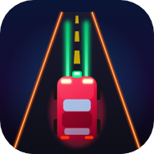

# 🚗 Combat Road — *neon car combat*

**Drive, blast and upgrade your way down an endless neon highway.** Shred enemy cars with 9 lasers, survive boss waves, grab power-ups, then spend your loot on upgrades, new cars and a permanent workshop. 💥

[](https://jaineil32624.github.io/Combat_Road/)
[](https://github.com/jaineil32624/Combat_Road/releases/latest/download/CombatRoad.apk)
[](https://github.com/jaineil32624/Combat_Road/releases/latest)


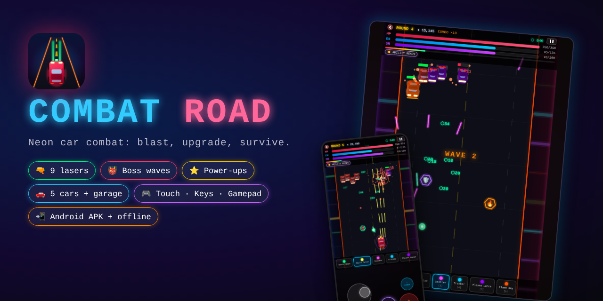

</div>

---

## ✨ Features

| | Feature | What it does |
|---|---|---|
| 🔫 | **9 lasers** | Basic, Rapid, Heavy, Scatter, homing Tracker, Plasma, Ice (slows), Flame (burns), piercing Dark Matter |
| 👹 | **Boss waves** | A *Road Warden* mini-boss every 5 rounds and the *Warlord* every 10, with a boss HP bar, radial bullet bursts and an enrage phase |
| ⭐ | **Power-ups** | ❤️ repair · ⚡ energy · 🛡️ shield · 🔥 rapid fire · 🧲 magnet · 💣 nuke, dropped by wrecked cars |
| ⬡ | **Upgrade Depot** | 45 upgrades between rounds: crits, chain bolts, explosive hits, drones, Time Warp, Overclock, Auto-Fire, plus repairs and rerolls |
| 🚗 | **Garage** | Unlock 5 cars (Striker, Viper, Juggernaut, Phantom, Inferno) and permanent workshop upgrades with 🪙 coins from your score. Progress is saved |
| 🏆 | **Leaderboard** | Local top 25 with round, kills and ★ score, plus your personal best on the menu |
| 📱 | **Touch controls** | Floating joystick and FIRE / ABILITY / LASER buttons in a thumb area *below* the road, so they never cover your car. Side bands in landscape |
| 🎮 | **Gamepad** | Stick/D-pad to drive, A/RT fire, X/B ability, LB/RB lasers, Start to pause |
| ⏸️ | **Pause menu** | Resume, settings, controls, restart or quit. Auto-pauses when you switch apps |
| ⚙️ | **Settings** | Sound & music volume, screen shake, reduced effects, Easy/Normal/Hard, touch mode, vibration, FPS meter |
| 💥 | **Juice** | Screen shake, hit flashes, shockwave rings, chain lightning, rammer charge warnings, haptics |
| 🎨 | **3 themes** | 🌈 Friendly · 🌸 Girly · 😈 Devil animated menus (remembered) |
| ⌨️ | **Shortcuts** | `WASD`/arrows · `Space` fire · `E` ability · `Q`/`1-9` lasers · `P`/`Esc` pause · `M` mute · `F` fullscreen · `?` help |
| 📲 | **Get the app** | Android APK, one-tap PWA install, iPhone *Add to Home Screen*, offline zip |

## 📸 Screenshots

<table>
<tr>
<td>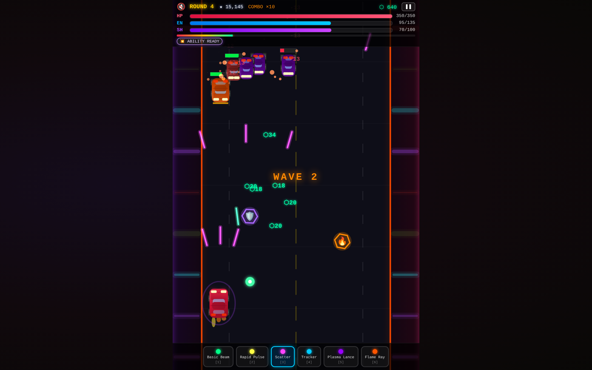<p align="center">💥 <b>Mid-game action</b>: scatter laser, power-ups, credit drops</p></td>
<td>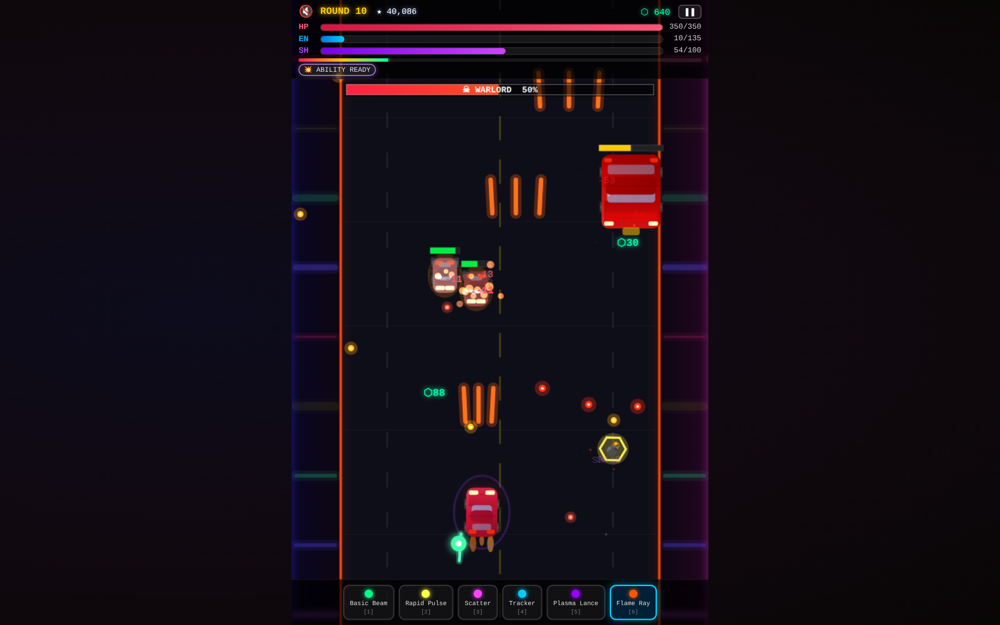<p align="center">👹 <b>Boss fight</b> against the Warlord</p></td>
</tr>
<tr>
<td>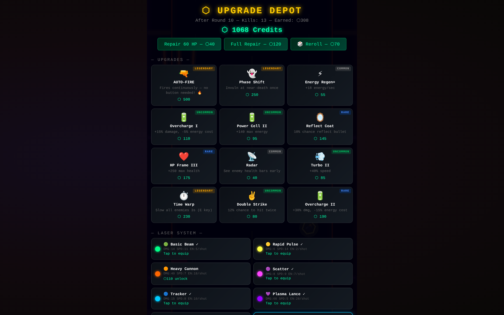<p align="center">⬡ <b>Upgrade Depot</b> between rounds</p></td>
<td>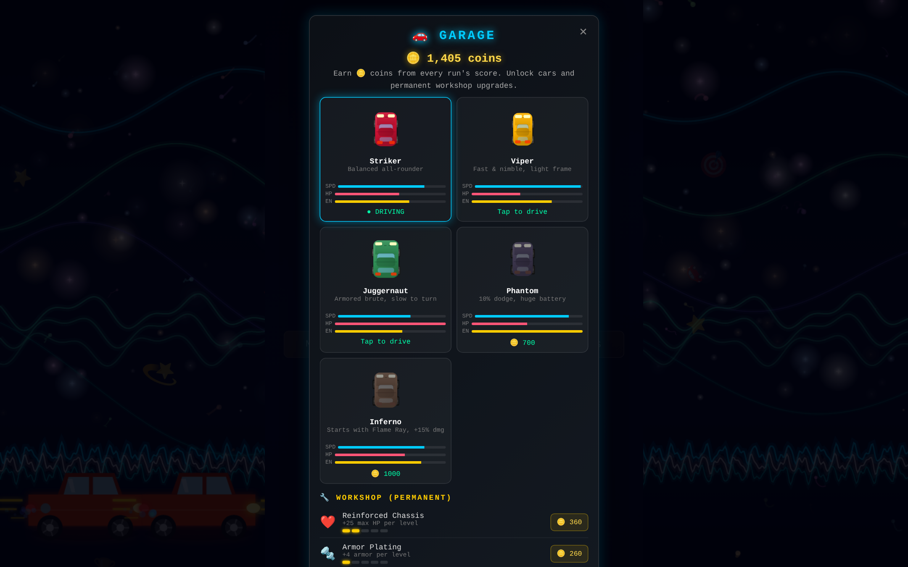<p align="center">🚗 <b>Garage</b>: cars & permanent upgrades</p></td>
</tr>
<tr>
<td>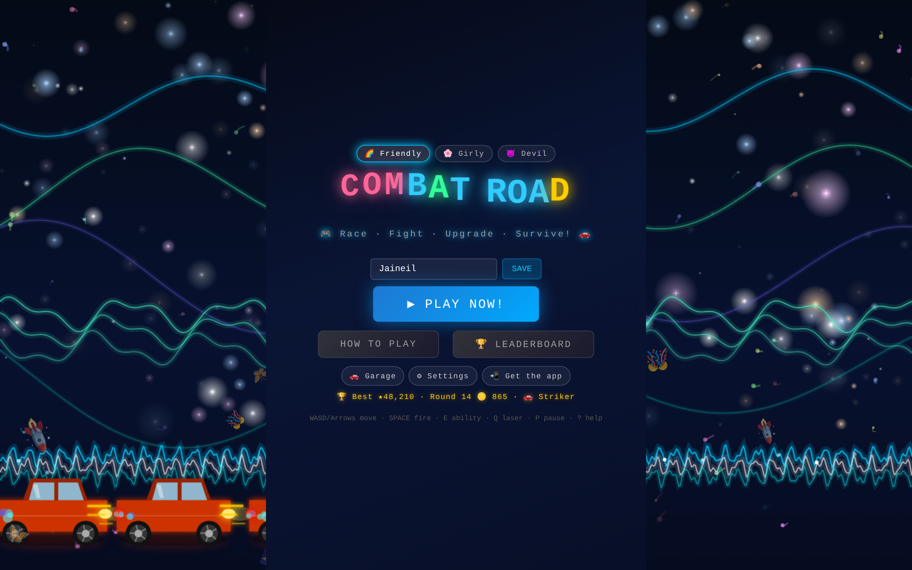<p align="center">🌈 <b>Main menu</b> with your best score</p></td>
<td>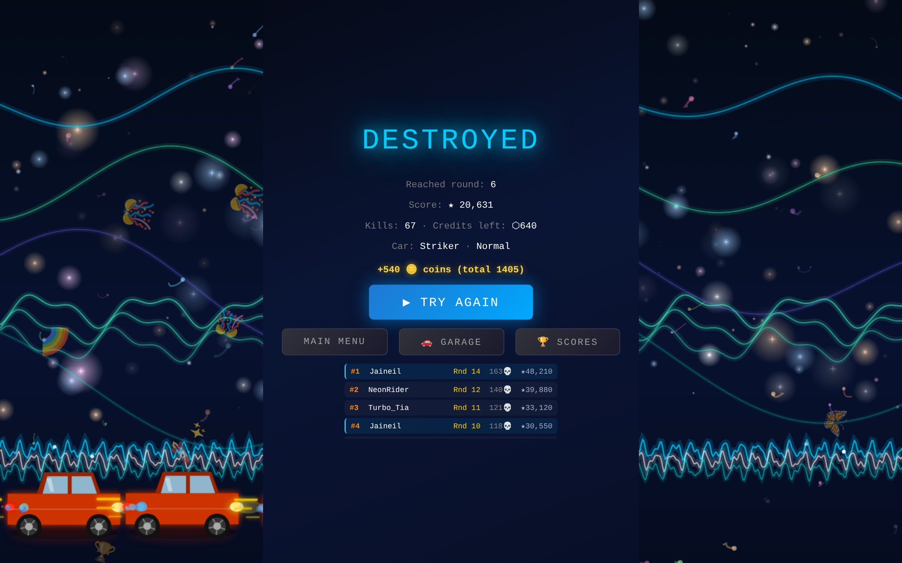<p align="center">🏆 <b>Game over</b>: coins earned + leaderboard</p></td>
</tr>
<tr>
<td>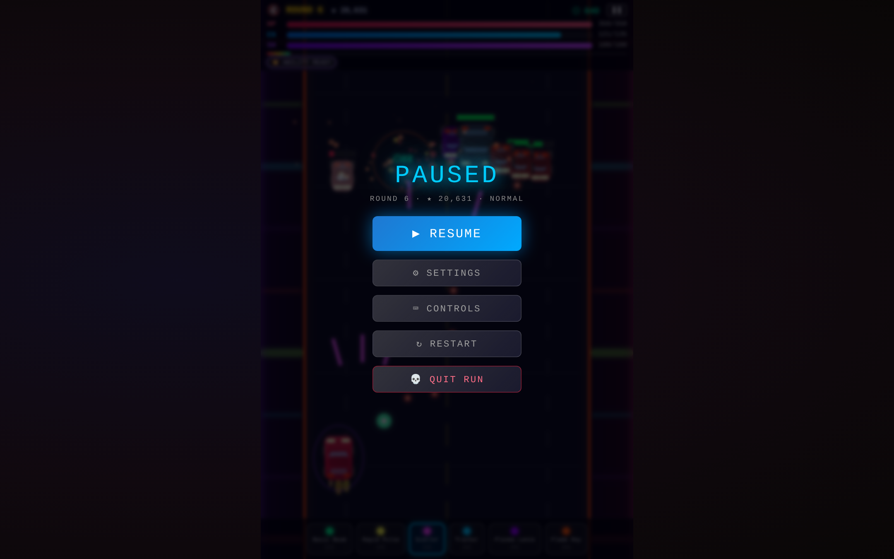<p align="center">⏸️ <b>Pause menu</b></p></td>
<td>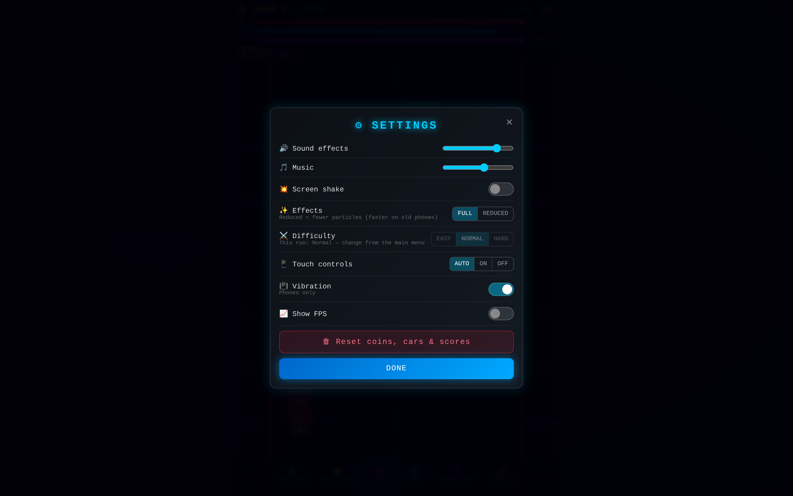<p align="center">⚙️ <b>Settings</b></p></td>
</tr>
<tr>
<td>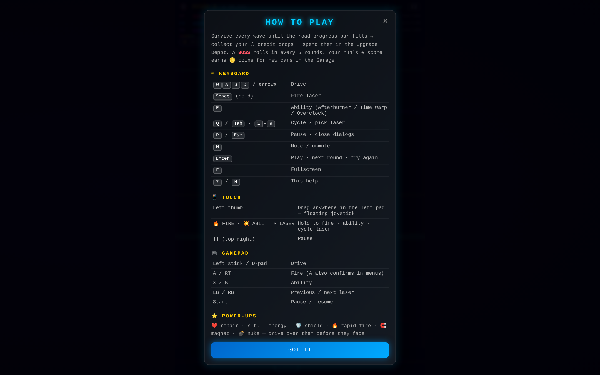<p align="center">⌨️ <b>Controls</b>: keyboard, touch & gamepad</p></td>
<td>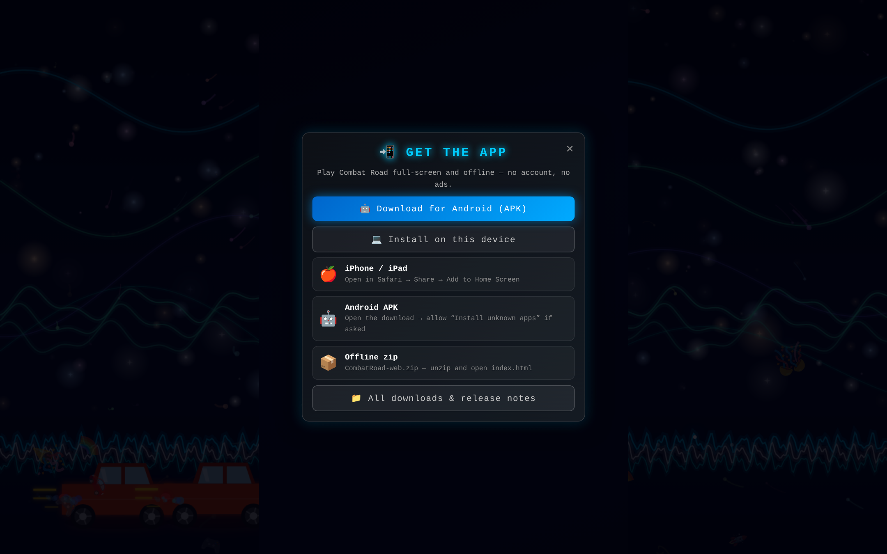<p align="center">📲 <b>Get the app</b></p></td>
</tr>
</table>

<p align="center">
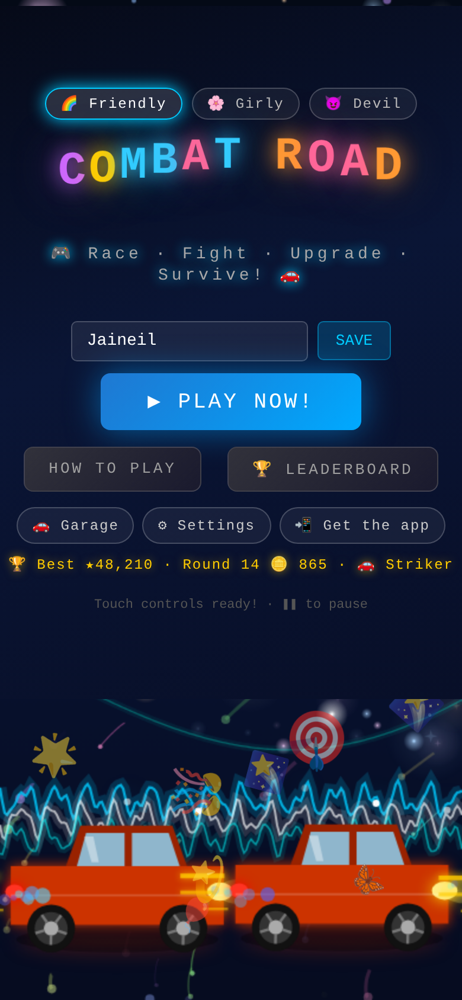
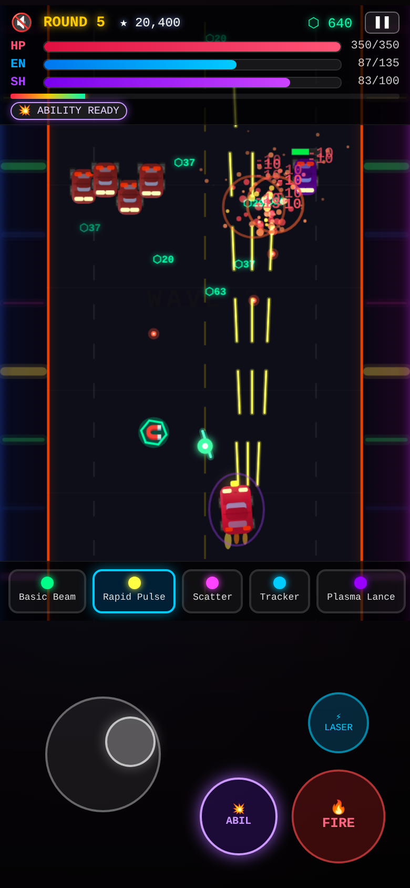
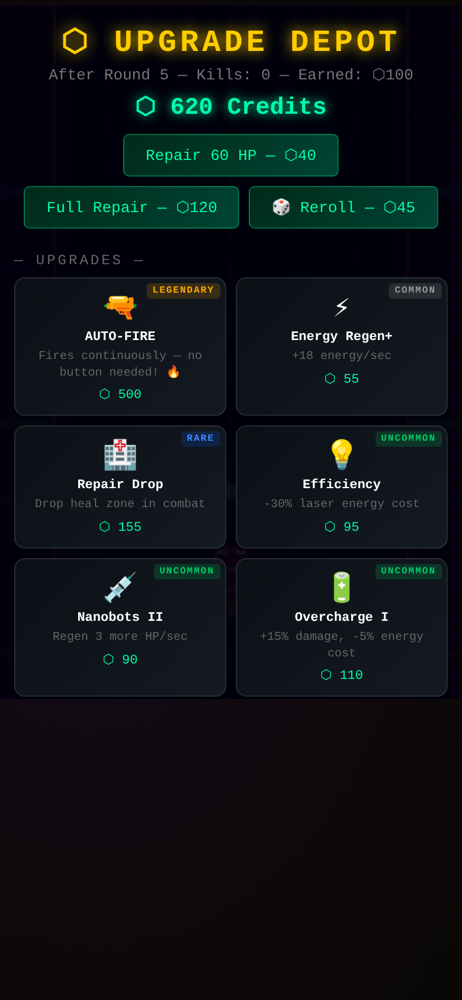
<br><em>📱 Made for phones: crisp on high-DPI screens, thumb controls below the road</em>
</p>

## 📥 Get Combat Road

| Platform | How |
|---|---|
| 🌐 **Web** | Play at **[jaineil32624.github.io/Combat_Road](https://jaineil32624.github.io/Combat_Road/)**. Nothing to install |
| 🤖 **Android** | Download **[CombatRoad.apk](https://github.com/jaineil32624/Combat_Road/releases/latest/download/CombatRoad.apk)** → open it → allow *Install unknown apps* if asked |
| 💻 **Windows / Mac / Chromebook** | Open the website in Chrome or Edge → **📲 Get the app** → **Install** |
| 🍎 **iPhone / iPad** | Open the website in Safari → **Share** → **Add to Home Screen** |
| 📦 **Offline zip** | Grab **CombatRoad-web.zip** from [Releases](https://github.com/jaineil32624/Combat_Road/releases/latest), unzip, open `index.html` |

> 💡 Works **100% offline** once installed. No account, no ads, no tracking: coins, cars and scores stay on your device.

## 🕹️ How to play

1. **Drive** with `WASD`/arrows, the touch joystick or a gamepad stick, and **hold fire** to shoot.
2. Survive every wave until the road **progress bar** fills, collecting ⬡ credit drops and ⭐ power-ups.
3. Spend credits in the **Upgrade Depot**: new lasers, stats, abilities (`E`).
4. Every **5th round is a boss round**. When you're wrecked, your ★ score turns into 🪙 coins for the **Garage**.

## 🛠️ Run it locally

```bash
git clone https://github.com/jaineil32624/Combat_Road.git
cd Combat_Road
python3 -m http.server 8000      # then open http://localhost:8000
```

It's a single `index.html`: no build step, no dependencies.

## 🗂️ Project structure

```
Combat_Road/
├── index.html              🧱 the whole game: canvas renderer, AI, shop, garage, synth audio
├── sw.js                   📴 offline service worker
├── manifest.webmanifest    📲 installable-app manifest
├── icons/                  🖼️ app icons (SVG + PNG + maskable)
├── docs/screenshots/       📸 images for this README
├── VERSION                 🏷️ bump to publish a new release
└── .github/workflows/
    └── release.yml         🤖 builds the Android APK + publishes a Release
```

## 🚀 Releasing a new version

Bump the number in `VERSION` and push. GitHub Actions builds the APK and publishes the release automatically:

```bash
echo "1.1.0" > VERSION
git commit -am "Release 1.1.0" && git push
```

---

<div align="center">

Made with ❤️, ⚡ and a lot of 🚗💥 by **[Jaineil Rana](https://github.com/jaineil32624)**

⭐ *If Combat Road wrecked you in the best way, give it a star!* ⭐

</div>
